# SpellWell · 拼写小屋

面向小学 1—2 年级的英文**拼写**记忆工具。只保留「看词 → 拼写 → 判定 → 调度」闭环：
不做听力、不做选择题（判断+改错除外）、不做图片配对、不做积分/排行榜。

- **定位**：纯前端 ES Modules，无构建、无框架、无运行时依赖；后期可平移 Node 后端。
- **当前阶段**：**P10/P11 已完成 ✅**；下一步 P12 平移准备。
- **需求源**：[`docs/DESIGN.md`](docs/DESIGN.md)（定稿 v1.2）。

---

## 快速开始

需要 Node 18+（仅用于测试与本地静态服务器，应用本身跑在浏览器）。

```bash
# P9 阶段门禁（累计 P0..P9）
node tests/runTests.js --phase=p9

# 本地预览：ESM 不能走 file://，必须用 HTTP
node tools/serve.mjs
# → http://0.0.0.0:4173

# 等价 npm 脚本（若使用 npm）
npm test
npm start
```

> 若系统 PATH 中没有 `node`，在 DSH 环境可用
> `/Users/Dr/.dsh/dsh-runtimes/dsh-primary-runtime/dependencies/node/bin/node`
> 执行上述命令。项目本身不绑定该路径。

打开预览页会进入学习端：题量由后台设置，默认 20，按所选单元实际词数封顶。
`?dev=1` 仍可查看 P0 开发状态页；`?debug=1` 会在学习端显示 AttemptResult 调试面板并暴露 `__SPELLWELL_DEBUG__`（含 scheduler）。
内容后台：`http://0.0.0.0:4173/admin`。
练习设置：`http://0.0.0.0:4173/admin/settings.html`。
同步设置：`http://0.0.0.0:4173/sync-setup`（详见 `docs/SYNC.md`）。
本机数据迁移：`/migration/index.html`。

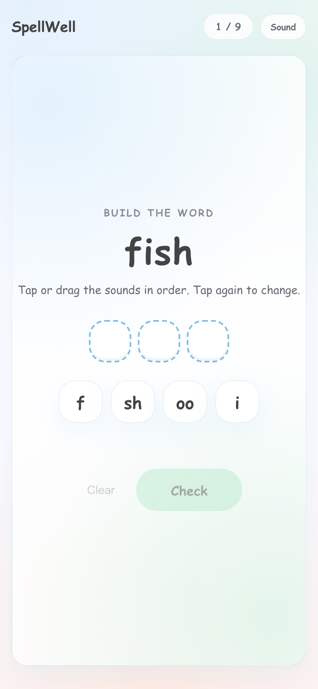

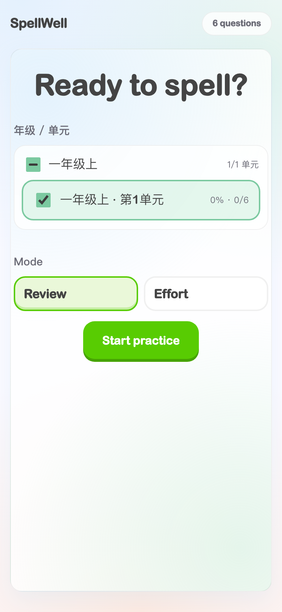

> T-SEQUENCE 拖拽重排时，其他块实时侧滑让位，缺口随左右半边移动：
> 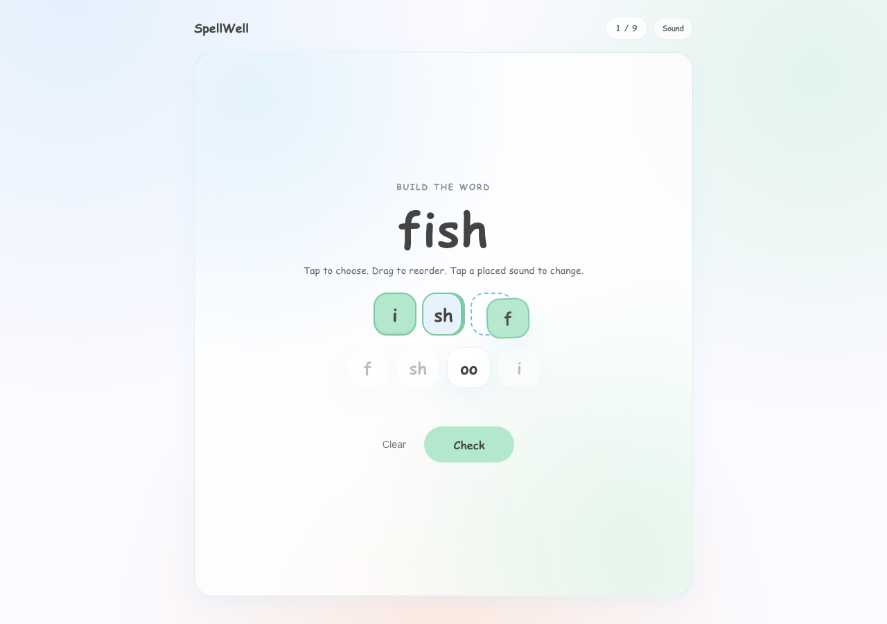

> P0 骨架自检页保留在 `?dev=1`：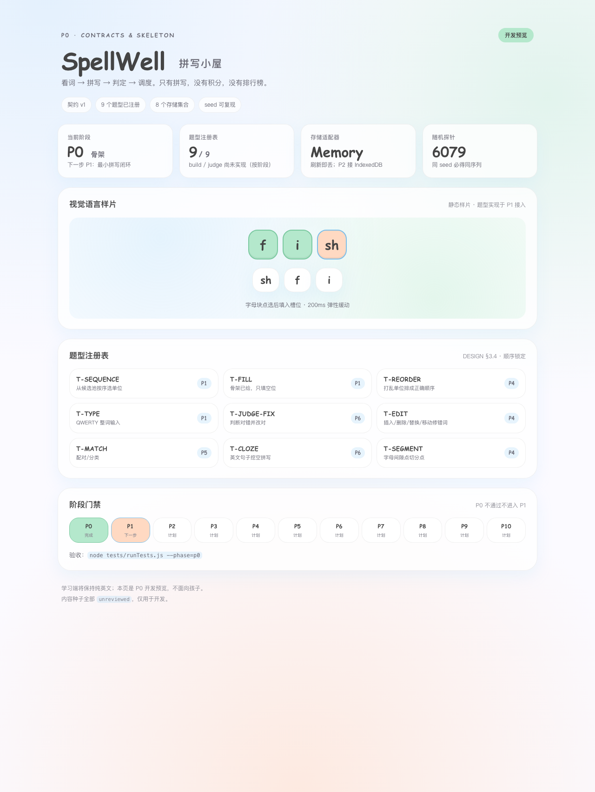

---

## 文档怎么贯穿整个开发过程

这不是“写完就归档”的设计文档，而是仓库里的可执行约束：

| 机制 | 文件 | 作用 |
|---|---|---|
| 唯一需求源 | [`docs/DESIGN.md`](docs/DESIGN.md) | 产品决策、架构铁律、阶段划分；改动先写 ADR |
| 条款追溯 | [`docs/TRACEABILITY.md`](docs/TRACEABILITY.md) | 每条规则 → 代码 → 测试 → 阶段 → 状态 |
| 阶段门禁 | [`docs/ROADMAP.md`](docs/ROADMAP.md) | P0—P12 验收标准；当前阶段只做当前阶段 |
| 工程规范 | [`docs/FILE_SPEC.md`](docs/FILE_SPEC.md) | 目录、命名、依赖方向、测试与禁止清单 |
| 内容规范 | [`docs/CONTENT_SPEC.md`](docs/CONTENT_SPEC.md) | 人工切分、ID 稳定性、校验规则 V1—V10 |
| 执行契约 | [`AGENTS.md`](AGENTS.md) | agent/贡献者必读顺序、铁律、完成定义、P10 启动提示词 |
| 决策记录 | [`docs/decisions/`](docs/decisions/) | 对文档歧义的裁决；ADR-0001—ADR-0018 |
| 代码头 | 每个 `src/**/*.js` | `@layer` / `@phase` / `@doc §x.y`，由测试校验 |
| 架构守卫 | `tests/p0/architecture.test.js` | 无 `Math.random`、无越层 import、无 DOM 泄漏、无循环依赖、仓库只用 7 个存储方法 |
| 文档守卫 | `tests/p0/traceability.test.js` | 枚举/阶段/token/ADR/零依赖与文档一致 |

因此，**改代码必须同步改追溯矩阵**；偏离设计必须先写 ADR。
门禁命令 `node tests/runTests.js --phase=pN` 是阶段推进的唯一硬标准。

---

## 目录速览

```
src/core          契约、seed 随机、时间、事件总线、错误
src/storage       StorageAdapter / MemoryAdapter / IndexedDBAdapter / contentImport / schema
src/repositories  词条、组合、句子、混淆项、状态、尝试
src/scheduler     间隔策略、错误画像、题型选择、每日队列/状态写入
src/questionTypes 9 个题型注册表；P1—P6 全部题型已实现
src/input         指针/键盘/挑战适配器（P10/P11 骨架）
src/ui            P3 学习端、PracticeSession、bootstrap 每日队列；P0 状态页
src/content       人工切分种子内容（全部 unreviewed）
tests/p0..p9      累计门禁：骨架 + P1—P8 + P9 计划/练习设计
docs              设计、规范、路线图、ADR
tools/serve.mjs   零依赖静态服务器
```

---

## 已固定的关键裁决

- 存储方法是 **7 个**：`init/get/put/query/transaction/exportAll/importAll`（DESIGN 原文“6 个”为笔误）。
- `wordState.errorProfile` 是有界数组（最多 8 条），`AttemptResult.firstError` 保留单条主错误。
- 学习状态枚举：词 `learning/reviewing/probe/mastered`，组合 `learning/reviewing/probe/steady`。
- P0 种子内容全部 `unreviewed`；生产导出只放行 `reviewed`（P7 实现阻断）。
- P2 的内容装配优先 IndexedDBAdapter；首次导入 content JSON，刷新按 `contentVersion` 跳过网络。
- P2 持久化内容与 8 个 store；P3 已在此基础上写 wordStates/attempts。
- P1 的 9 题是固定演示；P3 已改为 Scheduler 每日队列。
- P1 judge 上下文为 `{ spec, renderModel, events, bundle, now }`；不持久化任何学习状态。
- P1 只按 grapheme 整块选择；字母级/混合粒度是 P3/P4 预留，见 [`ADR-0004`](docs/decisions/0004-unit-granularity.md)。
- 同词同脚手架：`grapheme < mixed < letter`；难度是多维向量，P3 才校准权重，见 DESIGN §3.5 与 [`ADR-0006`](docs/decisions/0006-difficulty-gradient.md)；IndexedDB 内容导入见 [`ADR-0008`](docs/decisions/0008-indexeddb-content.md)。

详见 [`ADR-0001`](docs/decisions/0001-storage-contract.md)、[`ADR-0003`](docs/decisions/0003-p1-runtime-boundaries.md)、[`ADR-0004`](docs/decisions/0004-unit-granularity.md)、[`ADR-0005`](docs/decisions/0005-interaction-feedback.md) 与 [`ADR-0006`](docs/decisions/0006-difficulty-gradient.md)。

---

## P1 已实现

- `T-SEQUENCE`：按序点选单位，支持鼠标/触摸拖拽；靠近槽位 64px 吸附，未命中 240ms 弹回待选区；已到位块可拖拽重排，按目标块左右半边插前/插后并顺移；拖拽中其他块实时侧滑让位并显示缺口；点击已填槽位可取消；已使用的灰色待选项禁用；错误定位到 `OMISSION` / `SUBSTITUTION` / `EXTRA` / `TRANSPOSITION`。
- `T-FILL`：骨架已给、只填空位，候选池含干扰组合。
- `T-TYPE`：整词输入，按 grapheme unit 定位错误。
- `PracticeScreen`：纯英文学习端，点选/拖拽/键盘输入、显式 Check、温和反馈、`?debug=1` 调试面板。
- 互动音效：Web Audio 合成轻提示音（选中/拾取/吸附/取消/返回/对/错/完成），Header 有 Sound/Muted 开关。
- 3 词 × 3 题型完整闭环；同 `spec.seed` 渲染稳定；P1 行为保持不回退。

---

## P2 已实现

- `IndexedDBAdapter`：7 个存储方法、事务、等值查询、8 个 store 的 `exportAll` / `importAll`。
- 内容导入：`contentImport.js` 写入 `words/graphemes/sentences/confusables`，`meta.contentVersion` 幂等。
- 刷新不丢：首次加载导入，之后直接读 IndexedDB，不再请求 `/src/content/*.json`。
- IndexedDB 不可用时回退 `MemoryAdapter`；`?debug=1` 暴露 `window.__SPELLWELL_DEBUG__` 用于验收。
- P2 仍不写 `wordStates/graphemeStates/attempts`；学习状态留给 P3。

---

## P3 已实现

- `Scheduler.buildDailyQueue()`：5—8 个词，错词/错误画像 → 到期 → 新词 → 填充；默认 6。
- `Scheduler.recordAttempt()`：attempts + wordStates 落 IndexedDB；答错降 2 档、次日 `dueDate`，答对升档并清空错误画像。
- `TypeSelector` 按错误类型选 P1 修复题型；P4 题型被 `available` 过滤。
- `QuestionSpecBuilder` 为每个 spec 写入难度向量；`PracticeSession` 支持注入 Scheduler specs。
- 学习端队列显示 `1 / 6`；刷新后尝试与状态仍在，内容不再重复请求。

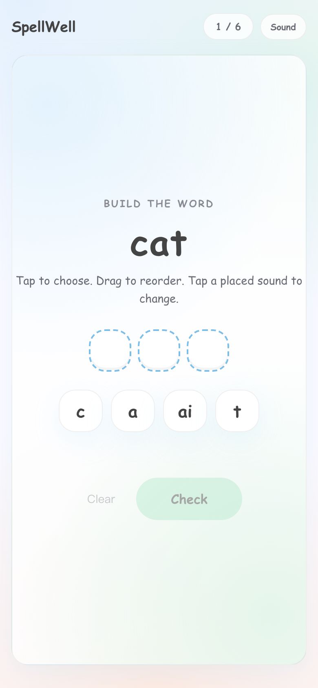

---

## P4 已实现

- `T-REORDER`：单位打乱，点两块交换；judge 按 `reorder` 事件重建顺序，定位 TRANSPOSITION。
- `T-EDIT`：按错误类型预填错词（OMISSION/EXTRA/TRANSPOSITION/SUBSTITUTION），输入修错后判定。
- `T-SEGMENT`：逐字母 + 间隙点；区分过度切分、切分不足、位置错。
- Scheduler 错误映射：TRANSPOSITION→T-REORDER、SUBSTITUTION→T-EDIT、BOUNDARY_*→T-SEGMENT。
- 三种交互均支持 Check/清空，结果继续写入 P3 的 wordStates/attempts。

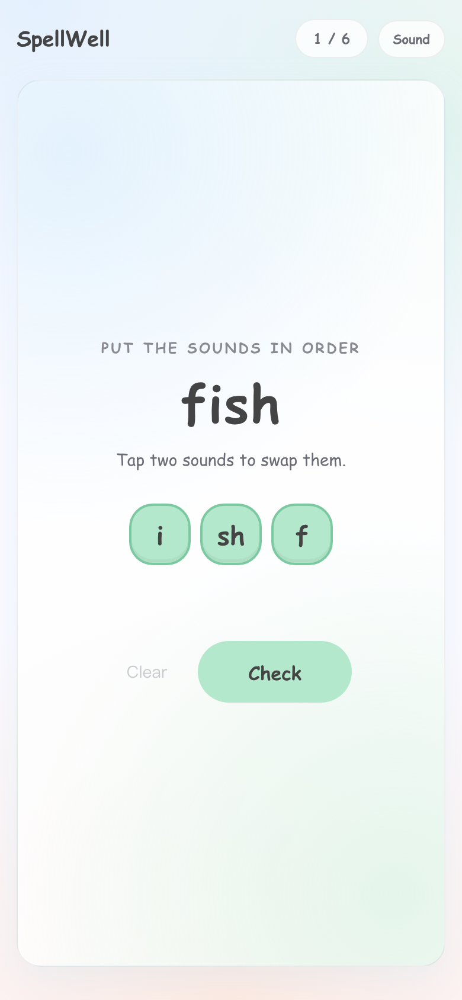

---

## P5 已实现

- `T-MATCH`：focus 组合 + 2—3 个包含词 + 1—2 个不包含词；多选分类，不是四选一。
- 组合独立状态：`intervalIndex`、`consecutiveCorrect`、`wordsPassed`、`dueDate`、`status`。
- 跨 2 个不同词、连续 3 次正确 → `probe` 候选。
- 每日最多 1 个 T-MATCH 强化包；队列不超过 8。
- 学习端 T-MATCH 多选/Check/Clear，结果继续写入 P3 状态。

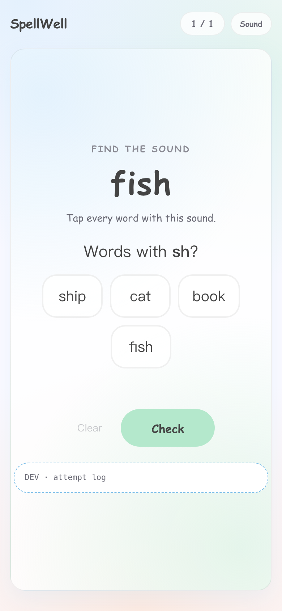

---

## P6 已实现

- `T-JUDGE-FIX`：显示 claim，选择 Correct/Wrong；判错时预填输入框改对，区分假接受/假拒绝。
- `T-CLOZE`：英文句子挖空，输入目标词，不做选项。
- probe：30 天满档连续 3 次正确 → `probe`，60 天后抽查。
- probe 答错退回 `learning`/次日，答对 → `mastered`/无 next due。
- Scheduler 对 probe 优先 T-CLOZE（有句子）或 T-JUDGE-FIX。

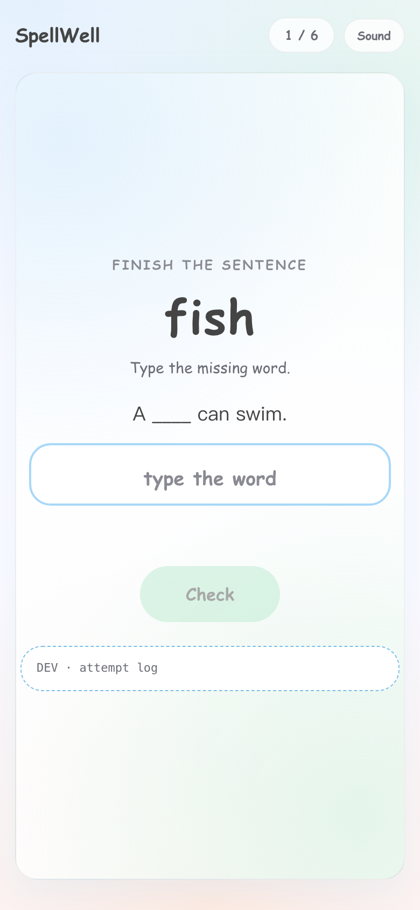

---

## P7 已实现

- `ContentValidator`：V1—V9 内容结构校验；V10 只导出 reviewed。
- 内容后台 `/admin`：搜索/列表/编辑器、单词/unit 维护、保存到共享 IndexedDB；学习端刷新可见。
- 批量录入：逗号显式切分，无逗号自动建议；支持中文翻译/音标。
- 组合库扩充到 152 项，覆盖单字母/辅音簇/双写/后缀；基础词库已审计切分。
- 例句 241 条、混淆项 7 组、词族 7 组；填空焦点支持 _ish / f_sh / fi_h；IPA 已补齐。
- 本机数据迁移独立：`/migration/index.html`，仅用于换主机时全量导出/导入 8 个 store。
- 后台不再要求内容 JSON 导出/导入；reviewed-only 校验保留，内容导出入口移除。
- 当前内容全部 `unreviewed`；V10 仍阻断生产导出。
- 后台不 import 状态仓库，不触碰 wordStates/graphemeStates/attempts。

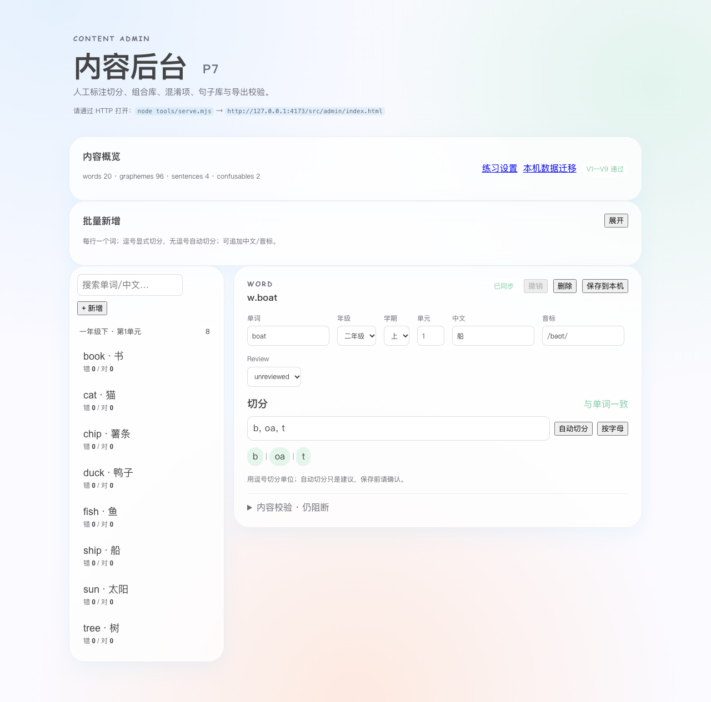

批量预览：

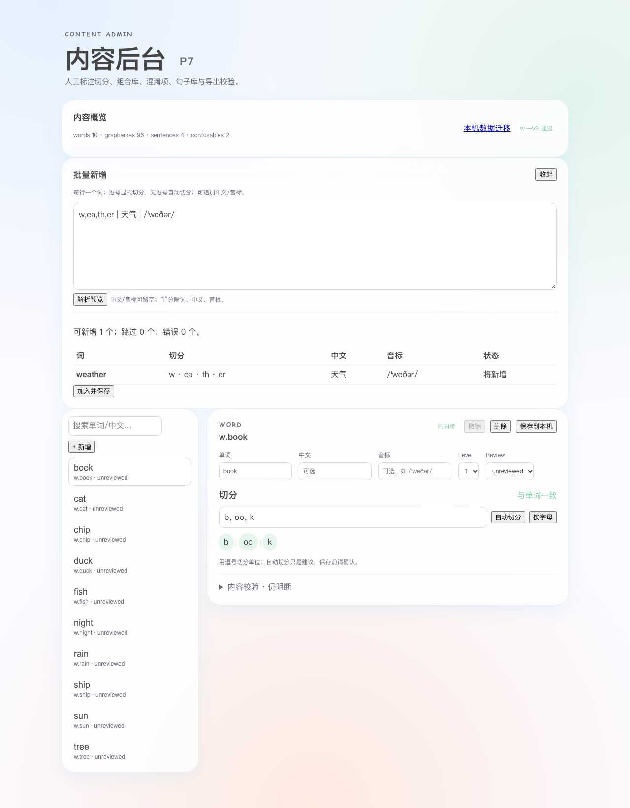

---

## P8 已实现

- 每题 Header `Stats`：查看历史报告；Back 返回。
- Done 页显示本次 `correct / total` 与正确率。
- 报告：本次练习、历史总览、最近 5 天、Word states、最近 10 次答案。
- 纯统计 `src/ui/analytics.js`，只读，不参与调度；无积分/排行榜。


---

## P9 已实现

- 两套教材词库：人教版新起点 583 词、外研版新交际（北京专版）891 词；后台可切换当前教材。
- 当前工程状态/数据/限制总览：[`docs/STATUS.md`](docs/STATUS.md)。
- 词库来源/质量/优化报告：[`docs/PEP_VOCAB_BASE.md`](docs/PEP_VOCAB_BASE.md)、[`docs/FLTRP_VOCAB_BASE.md`](docs/FLTRP_VOCAB_BASE.md)、[`docs/SEGMENTATION_AUDIT.md`](docs/SEGMENTATION_AUDIT.md)。
- 预制内容清单：[`docs/CONTENT_INVENTORY.md`](docs/CONTENT_INVENTORY.md)；练习流程：[`docs/SESSION_FLOW.md`](docs/SESSION_FLOW.md)。
- 设计页保留：记忆周期旧单元以只读“自动复习”显示；完全掌握不加入；只有下一个新单元可复选。
- 练习页 `Units` 可手动调整；设计页只显示已完成 + 下一个新单元。
- 提示中文为主、IPA 同屏辅助；低年级不单独用 IPA。
- T-CLOZE 显示例句中文翻译，避免填空答案歧义。
- 首次答错的词会在本轮后半段换一种题型再强化一次。
- 单词和例句使用浏览器原生语音朗读；答前不泄露 T-TYPE/T-CLOZE 答案。
- 答错显示正确答案并可重试，答对才进入下一题；结束页先展示正确率，再列错词。
- 后台题量默认 20，设置页 `/admin/settings.html`，面包屑返回内容库。
- 题量、单元、模式进入 Scheduler；真实 attempts 校准选词权重；当前会话不因内容更新中断。
- 每个计划项带 `reason/mode/policyVersion/score/calibration`；`revise()` 接口预留。
- 提示词：中文语义优先，IPA 同屏辅助；低年级不单独用 IPA；句子只留给 T-CLOZE。
- 批量新增支持单元标题行，如 `一年级上unit2`；后续词继承该单元直到下一个标题。
- 词库支持单独 JSON 导入/导出；重复词可合并/替换/不动。

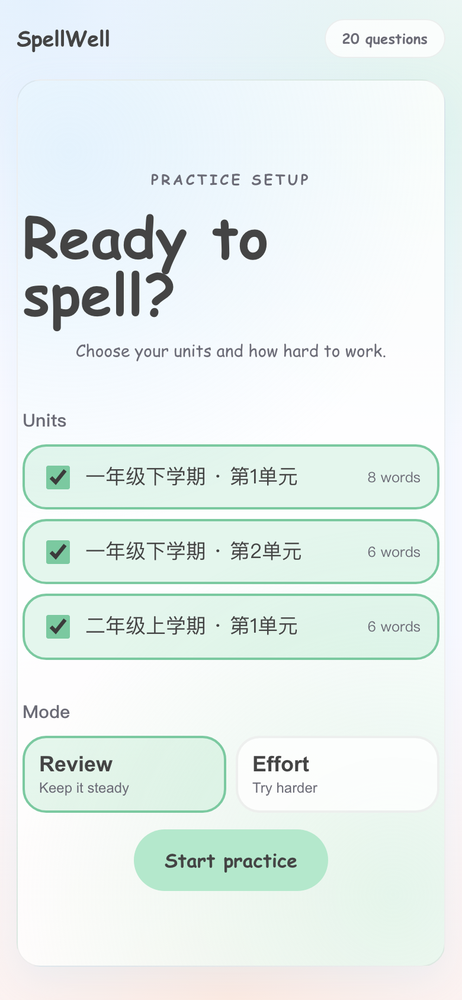

提示词示例（音标）：


---

## 下一步

P10：抽取 Pointer/Keyboard 输入适配器，完成鼠标/触摸/键盘双端一致与移动端体验；
不新增依赖，不提前做挑战模式。
任务书与启动提示词见 [`docs/ROADMAP.md`](docs/ROADMAP.md) 与 [`AGENTS.md`](AGENTS.md)。
